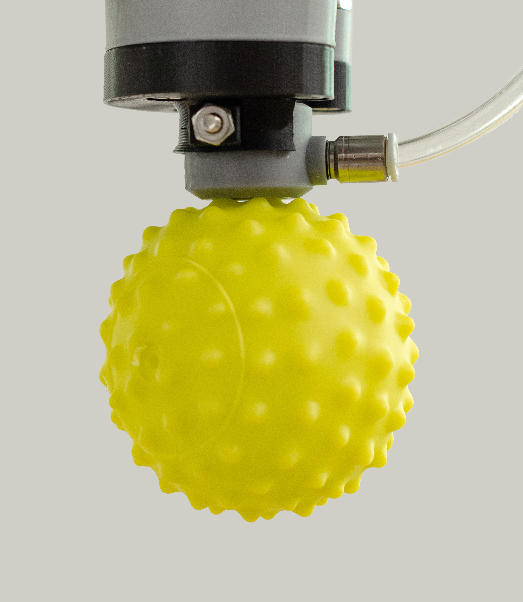
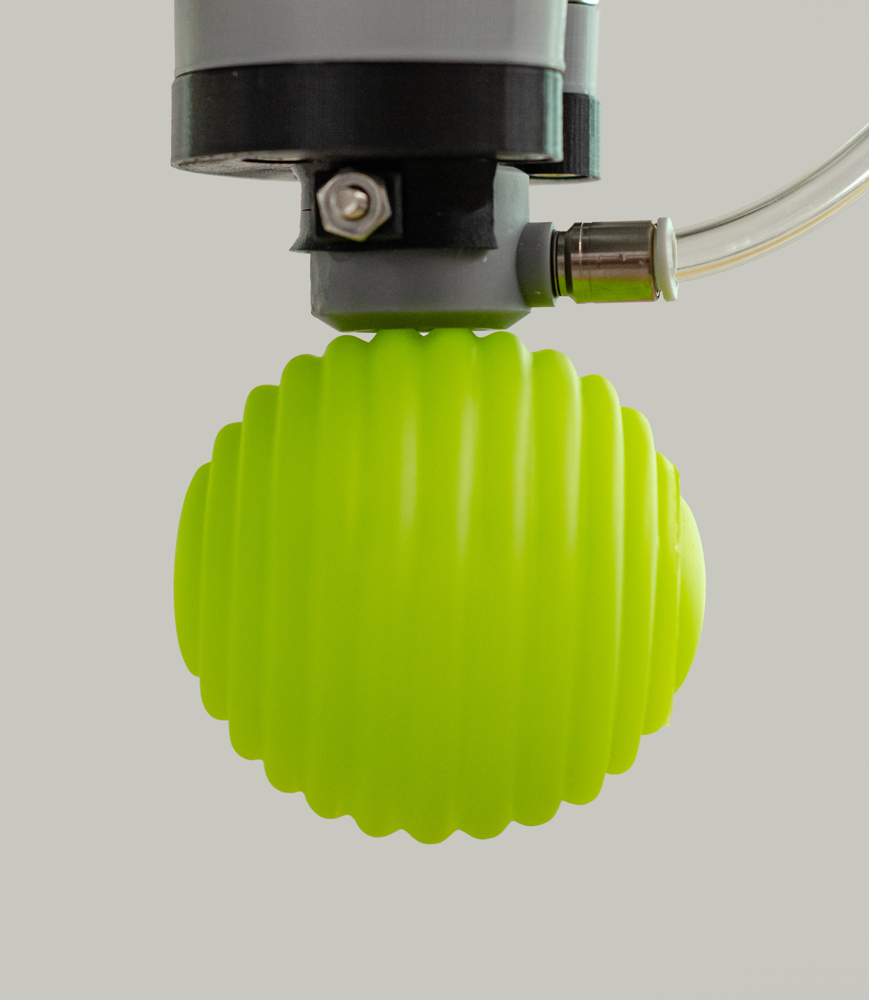
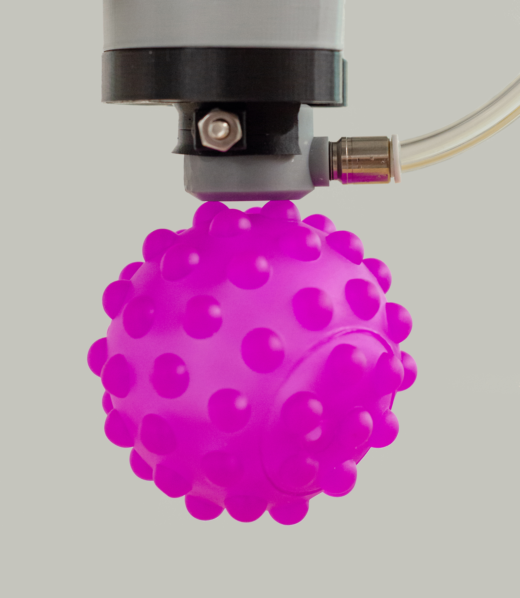
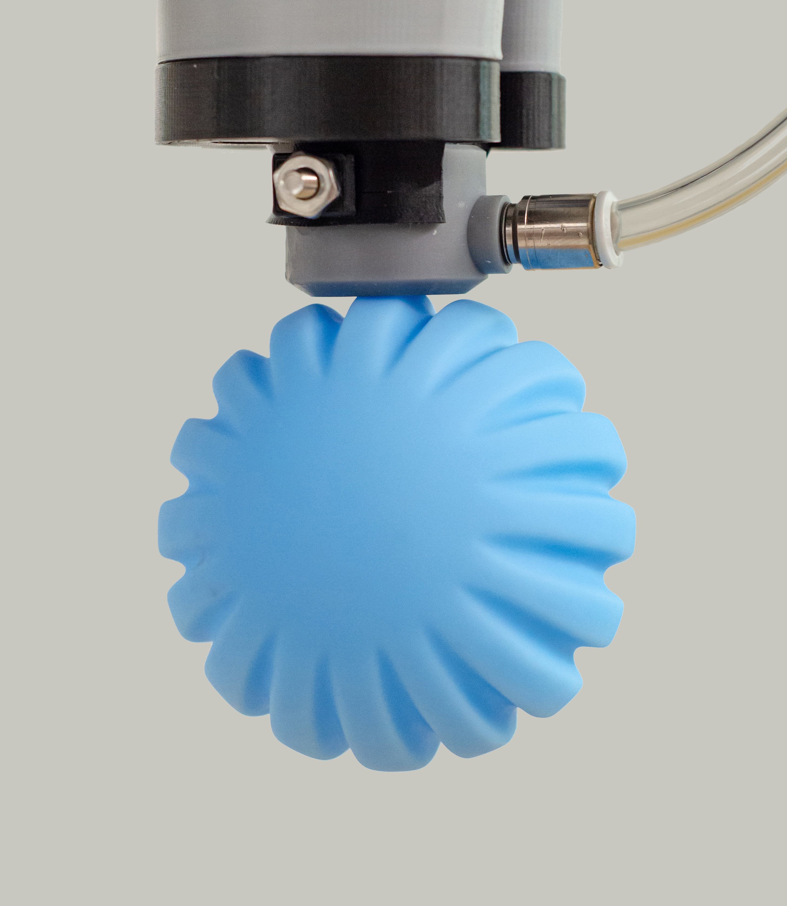
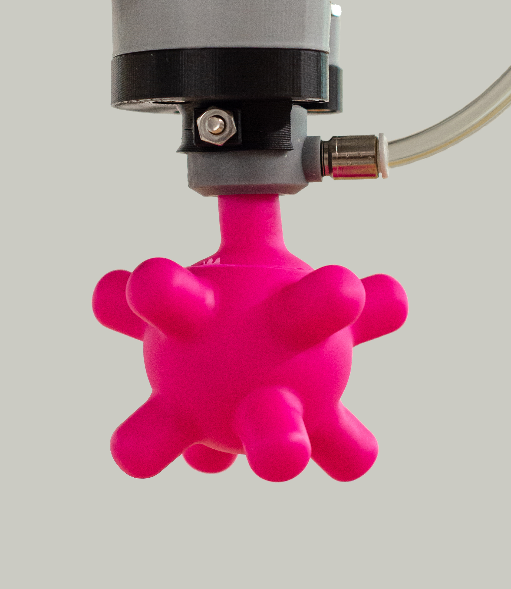

## Description
This project develops robotic grasping systems and manipulation methods for delicate soft tissues, with the goal of minimizing direct contact and reducing the risk of tissue damage in medical applications. The research focuses on pneumatic vortex grippers, which use controlled swirling airflow to generate a low-pressure region and produce lifting force. This approach offers an alternative to conventional tissue grasping through mechanical pinching, while addressing the challenges of handling compliant objects with complex surface geometries.

The project combines gripper design, experimental characterization, and data-driven modeling to understand how tissue geometry and pneumatic parameters influence grasping performance. Experiments investigate the effects of surface curvature, nozzle diameter, and supply pressure on lifting force across a wide range of soft objects, including convex and concave surfaces. Studies using artificial tissue and ex vivo porcine intestine examine the practical opportunities and limitations of vortex-based grasping, including the role of friction elements in improving holding stability.

Beyond lifting and holding, the research examines vortex-induced torque to understand how airflow and object geometry affect rotational behavior during manipulation. These investigations support the development of design guidelines and predictive models for more reliable low-contact grasping. The long-term objective is to establish a foundation for robotic tissue-handling technologies that balance secure manipulation with gentle interaction, supporting future applications in medical and surgical robotics.

## Colaboration
* National Institute of Advanced Industrial Science and Technology (Japan).
* Texas Robotics, The University of Texas at Austin (USA).
* Walker Department of Mechanical Engineering, The University of Texas at Austin (USA).
* EPAM School of Digital Technologies, American University Kyiv (Powered by Arizona State University) (Ukraine).

## Results

The first step is the development of a low-contact gripper that would be able grasping and manipulate soft objects with different surface shapes. For example, during surgical applications, manipulation of various organs with convex and concave surfaces.

### Grasping Soft Balls of Various Shapes by Vortex Gripper

 | Grasping | Grasping | Grasping |
 | :---: | :---: | :---: |
 |   |      |    |
 |   |    |    |
 | - | - | - |

<iframe src="/files/Investigating_a_Fluidic_Vortex_Grasping_Mechanism_for_Complex_Objects_and_Bio-Inspired_Tissue.pdf" width="100%" height="600px">
    
Your browser does not support iframes. <a href="/files/Investigating_a_Fluidic_Vortex_Grasping_Mechanism_for_Complex_Objects_and_Bio-Inspired_Tissue.pdf">Download the PDF</a> instead.

</iframe>

## Datasets

To download the dataset obtained for the gripper with different nozzle diameters, follow the links:

<td><a href="/files/vortex/data_set_vortex_gripper(nozzle 0.6mm).zip" style="font-weight:bold">Download Vortex gripper dataset (nozzle diameter = 0.6 mm)</a> </td> If this doesn't work for you, use <a href="https://www.dropbox.com/scl/fi/zta0yljjgszxedm04ov30/data_set_vortex_gripper-nozzle-0.6mm.zip?rlkey=plche5yfpwoeibqyeqo1vvzjd&st=rzu7o8hz&dl=0" target="_blank" rel="noopener">Dropbox</a>.

<td><a href="/files/vortex/data_set_vortex_gripper(nozzle 0.8mm).zip" style="font-weight:bold">Download Vortex gripper dataset (nozzle diameter = 0.8 mm)</a> </td> If this doesn't work for you, use <a href="https://www.dropbox.com/scl/fi/9yjwomj025sbx8yfv604g/data_set_vortex_gripper-nozzle-0.8mm.zip?rlkey=7180pyncxrqkj25h6yvpebk2z&st=si3gu46p&dl=0" target="_blank" rel="noopener">Dropbox</a>.

<td><a href="/files/vortex/data_set_vortex_gripper(nozzle 1.0mm).zip" style="font-weight:bold">Download Vortex gripper dataset (nozzle diameter = 1.0 mm)</a> </td> If this doesn't work for you, use <a href="https://www.dropbox.com/scl/fi/tp1f7ewjhppx0sjyriqm9/data_set_vortex_gripper-nozzle-1.0mm.zip?rlkey=pta2wmtrqxsm0emlkm4k00mdl&st=aorq52wt&dl=0" target="_blank" rel="noopener">Dropbox</a>.

## Results Presentation

* R. Mykhailyshyn, T. Motoda, I. Virgala, A. Majewicz Fey, Y. Domae, &quot;Vortex-Induced Torque in Grasping Soft Objects: Influence of Geometry and Pneumatic Parameters.&quot; <i>IEEE/SICE International Symposium on System Integration (SII) 2027</i>, Accepted.
* R. Mykhailyshyn, A. Majewicz Fey &quot; Low-Contact Grasping of Soft Tissue Using a Novel Vortex Gripper.&quot; <i>IEEE 2024 International Symposium on Medical Robotics (ISMR 2024)</i> [IEEE](https://doi.org/10.1109/ISMR63436.2024.10585970).
* R. Mykhailyshyn, A. Majewicz Fey &quot; Low-Contact Grasping of Soft Tissue with Complex Geometry using a Novel Vortex Gripper.&quot; <i>IEEE/RSJ International Conference on Intelligent Robots and Systems (IROS 2023) Workshop on Robotics for the Gut</i>.

## Publications

* R. Mykhailyshyn, T. Motoda, I. Virgala, A. Majewicz Fey, Y. Domae, &quot;Vortex-Induced Torque in Grasping Soft Objects: Influence of Geometry and Pneumatic Parameters.&quot; <i>IEEE/SICE International Symposium on System Integration (SII) 2027</i> [IEEE](https://doi.org/10.______), Accepted.
* R. Mykhailyshyn, A. Majewicz Fey, &quot;Investigating a Fluidic Vortex Grasping Mechanism for Complex Objects and Bio-Inspired Tissue.&quot; <i>IEEE Access</i> [IEEE](https://doi.org/10.1109/ACCESS.2026.3706808).
* R. Mykhailyshyn, A. Majewicz Fey &quot; Low-Contact Grasping of Soft Tissue Using a Novel Vortex Gripper.&quot; <i>IEEE 2024 International Symposium on Medical Robotics (ISMR 2024)</i> [IEEE](https://doi.org/10.1109/ISMR63436.2024.10585970).